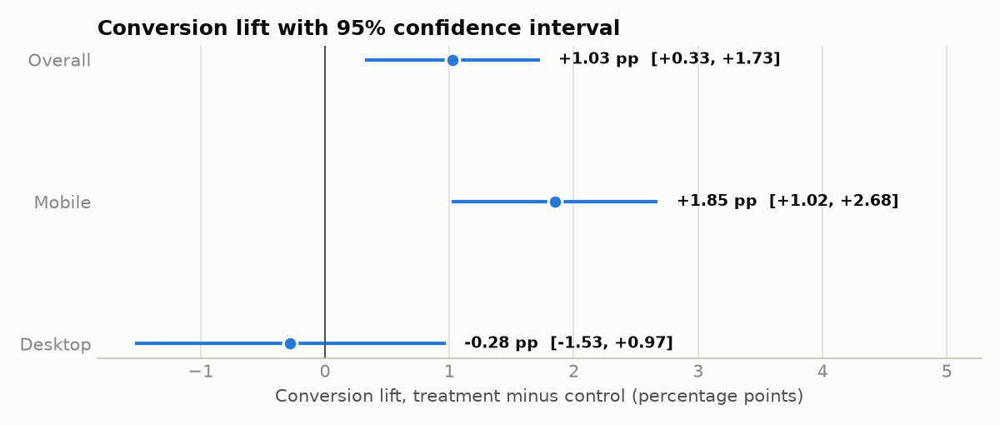
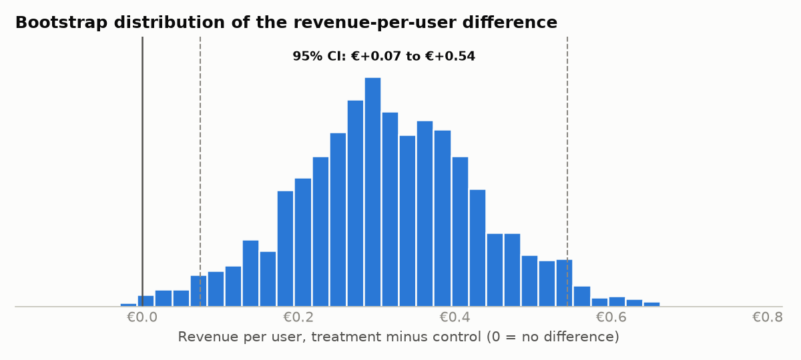

# A/B Test Analysis: Checkout Redesign

End-to-end analysis of a **simulated two-week A/B test**: does a redesigned one-page checkout (treatment) beat the existing multi-step checkout (control)? The report covers data validation, a pre-registered plan, primary / secondary / guardrail metrics, segment analysis and a ship decision, all in Python (pandas, SciPy).

> **The data is synthetic.** `generate_data.py` simulates 32,000 users with a fixed seed, using effects I chose. No real company or customer data is used. The point of the project is the **statistical method and the reasoning**, not the business result.

## Pre-registered plan (fixed before looking at results)

| Item | Decision |
|---|---|
| Unit | User who reached checkout, randomly assigned 50/50 |
| Primary metric | Conversion rate (purchase / user) |
| Secondary metric | Revenue per user (zeros included) |
| Guardrail | Refund rate among buyers must not rise by more than 1.0 pp |
| Test | Two-sided, alpha = 0.05, power = 80% |
| Minimum detectable effect | +1.0 pp on an 11% baseline, which needs about 15,973 users per arm |
| Segments | Device (mobile, desktop), Bonferroni-corrected for 2 comparisons |

## Results

| Check | Result |
|---|---|
| Sample ratio mismatch | 15,862 control vs 16,138 treatment, chi-square p = 0.123. No SRM, so the randomization looks healthy |
| **Conversion (primary)** | 11.05% to 12.07%: **+1.03 pp** (+9.3% relative), 95% CI [+0.33, +1.73], p = 0.0041 |
| Revenue per user | €3.08 to €3.39: **+€0.31** (+9.9%), bootstrap 95% CI [+€0.07, +€0.54], Welch p = 0.012 |
| Order value among buyers | €27.88 vs €28.05 (p = 0.78): the gain comes from more buyers, not bigger baskets |
| Guardrail: refund rate | 4.85% vs 4.41%, difference -0.44 pp, 95% CI [-1.79, +0.92]. Upper bound is below the +1.0 pp margin, so it **passes** |
| Mobile | **+1.85 pp**, CI [+1.02, +2.68], significant after correction |
| Desktop | -0.28 pp, CI [-1.53, +0.97], no detectable effect |
| Mobile vs desktop | Lifts differ by +2.13 pp (z = 2.78, p = 0.0054) |
| Week 1 vs week 2 | +1.19 pp vs +0.86 pp, with overlapping intervals |





### Recommendation

The test meets the pre-registered criteria: conversion is significantly higher, revenue per user is higher, and the refund guardrail passes. **Ship it**, with two caveats:

1. **The win is a mobile win.** Desktop shows no benefit, and its interval cannot rule out a loss of about 1.5 pp. Roll out to mobile first and keep a desktop holdout, or run a follow-up desktop test.
2. **The refund guardrail passed, but its interval is wide** (up to +0.92 pp against a +1.0 pp margin). Monitor refunds after launch.

The week 2 lift is smaller than week 1, but each week has half the data and the intervals overlap, so this is not evidence of a novelty effect. It is worth watching during rollout.

### Sanity check against the known truth

Because the data is simulated, I can compare the analysis with the effects I built in: +1.9 pp on mobile (estimated +1.85, CI covers it) and +0.2 pp on desktop (estimated -0.28, CI covers it). The overall true lift is about +1.25 pp against an estimate of +1.03, inside the CI. The methods recover the effects without bias.

## Methods used

- **Sample ratio mismatch check**: chi-square goodness-of-fit against the expected 50/50 split (alarm threshold p < 0.001).
- **Power analysis**: required sample size for the planned effect, and the smallest effect detectable with the actual sample (`brentq` solver).
- **Two-proportion z-test**: pooled standard error for the test, unpooled for the confidence interval.
- **Revenue per user** is zero-inflated and skewed, so the Welch t-test is paired with a **bootstrap CI** (2,000 resamples).
- **Guardrail as a non-inferiority check**: compare the CI upper bound with a margin chosen in advance, instead of only asking "is p < 0.05?".
- **Segment analysis** with Bonferroni correction, plus a direct test of the **difference in lift** between segments.
- **Stability over time** (week 1 vs week 2) as a novelty check.

## Limitations

- One simulated test with a fixed horizon. Looking at results early and stopping would inflate false positives; sequential testing would be needed for that.
- No variance reduction (such as CUPED), which would tighten the intervals.
- Order value among buyers is descriptive only: conditioning on a post-treatment outcome (buying) can bias a comparison.
- Segments beyond device are not examined, on purpose: more cuts mean more false positives.

## Run it

```bash
pip install -r requirements.txt
python generate_data.py     # writes data/experiment.csv
python analyze.py           # prints the full report, writes results/summary.txt and charts
```

## Project layout

```
generate_data.py          simulates the experiment (seeded, reproducible)
analyze.py                the full analysis, with the pre-registered plan in its docstring
data/experiment.csv       user_id, arm, device, exposure_date, converted, order_value, refunded
results/summary.txt       full text report
results/*.png             charts
```
